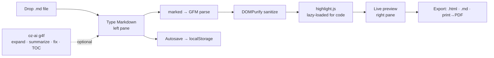

# oriz-md — Markdown Studio

> A free, split-screen editor for GitHub-Flavored Markdown — write on the left, see the rendered preview on the right in real time, then export HTML, MD, or PDF.

[](LICENSE)
[](https://github.com/chirag127/oriz-md/stargazers)
[](https://github.com/chirag127/oriz-md/commits)
[](https://astro.build)

**Live app:** https://md.oriz.in · **GHP landing:** https://chirag127.github.io/oriz-md/ · **Repo:** https://github.com/chirag127/oriz-md

If this is useful, please ⭐ [star the repo](https://github.com/chirag127/oriz-md) — it helps others find it.

**100% client-side — no upload, no signup, free.** Every keystroke, render, and export happens in your browser; nothing is sent to a server.

## How it works



## Features

- **Live GFM preview** — headings, tables, task lists, autolinks, strikethrough (`marked` + DOMPurify).
- **Syntax highlighting** — highlight.js, lazy-loaded only when your document has code.
- **Table of contents** — auto-generated from your headings, with anchor links.
- **Export** — download standalone `.html` or `.md`, or **print → PDF**.
- **Focus mode** — dims everything but where you're writing.
- **AI assist (optional)** — expand an outline, summarize, fix markdown, or generate a TOC via free g4f providers with failover; if AI is down, the editor is untouched.
- **Autosave** — persists to `localStorage`.
- **Drag & drop** — drop a `.md` file onto the editor to open it.
- **PWA** — installable, works offline after first load.

## Tech stack

- **Astro 6** (static output) + **React 19** island
- **Tailwind CSS v4** via `@tailwindcss/vite`
- **marked** (GFM parse) + **DOMPurify** (sanitize) + **highlight.js** (lazy code highlighting)
- **@vite-pwa/astro** for the installable PWA
- Shared `@chirag127/oz-*` packages: `oz-ai` (keyless g4f client), `oz-file`, `oz-tokens-base`, `oz-chrome`
- Deployed on **Cloudflare Pages**; the GHP landing is served from GitHub Pages

## Repo structure

```
oriz-md/
├── src/
│   ├── components/Studio.tsx     # main React island — editor + preview
│   ├── lib/markdown.ts           # marked config (GFM)
│   ├── lib/render.ts             # parse → sanitize → highlight pipeline
│   ├── lib/exportHtml.ts         # standalone .html export
│   ├── lib/sample.ts             # default sample document
│   ├── layouts/Base.astro        # page shell (oz-chrome)
│   ├── pages/index.astro         # single-page entry
│   └── styles/                   # app.css + theme.css (--oz-* tokens)
├── astro.config.mjs
├── tests/                        # vitest unit tests
└── package.json
```

## Quick start

```bash
npm install --legacy-peer-deps
npm run dev      # local dev server
npm test         # vitest unit tests
npm run build    # static build → dist/
npm run deploy   # build + wrangler pages deploy
```

> Windows note: use **npm**, not pnpm (pnpm skips `@esbuild/win32-x64` and the build crashes).

## Configuration

No configuration required — the app is fully client-side. The optional AI feature uses the keyless `@chirag127/oz-ai` g4f client (no API key, no env vars).

## Part of the oriz family

oriz-md is one of ~80 small, single-purpose tools in the [oriz](https://blog.oriz.in) family — each doing one thing well and running **$0 on the Cloudflare free tier**. Start at the hub, [oriz-home](https://oriz.in), or try a sibling like [oriz-dev](https://dev.oriz.in) (developer multitool) or [oriz-qr](https://qr.oriz.in) (QR studio).

## Contributing

Issues and PRs welcome. Keep it client-side and dependency-light; add a vitest case for any new render/export logic. Conventional commits are the changelog.

## Status

Stable and live at https://md.oriz.in.

## License

MIT © Chirag Singhal — chirag@oriz.in
